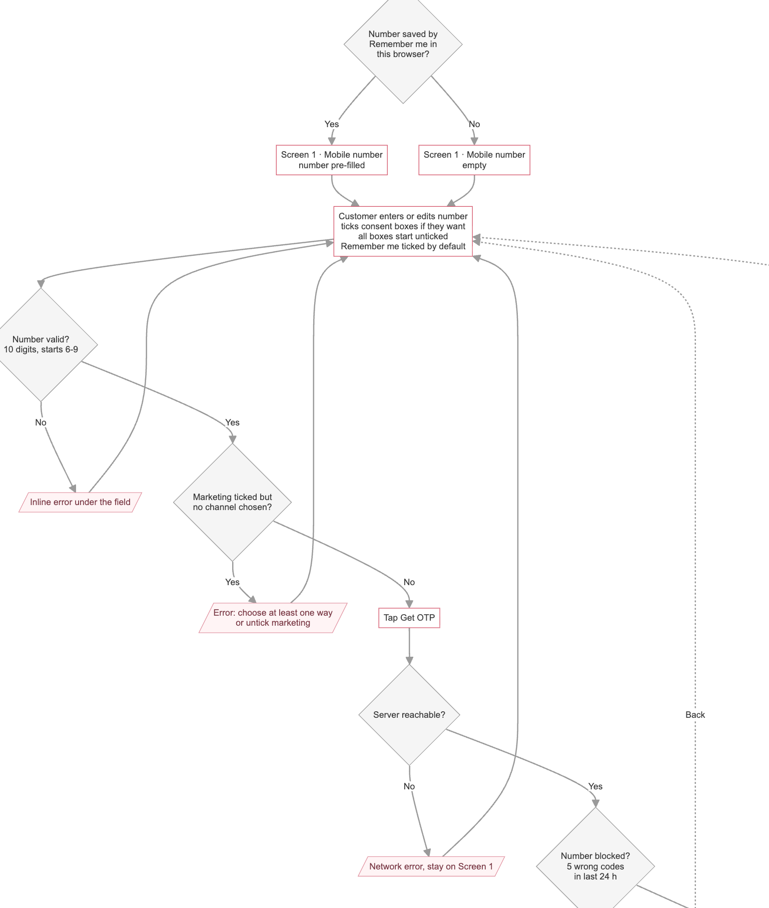
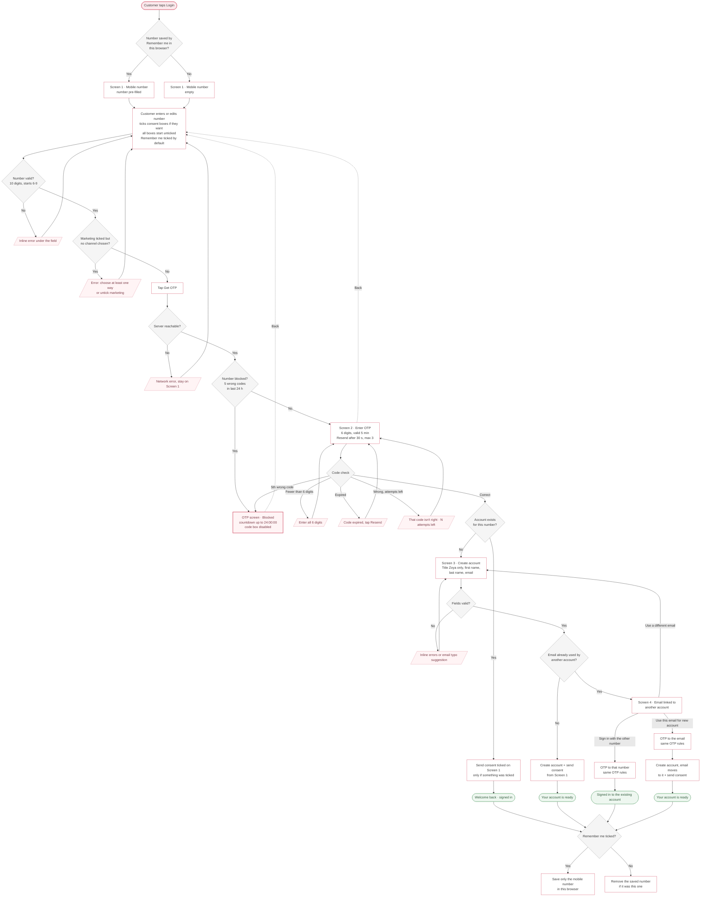

# Login / Sign-up flow (Mia)

## The flow, step by step

**1. Mobile number screen**
- If **Remember me** saved a number in this browser, it is pre-filled. Otherwise the field is empty.
- Consent boxes are **always unticked**. Nothing is remembered or fetched.
- Remember me is ticked by default.
- No block or account check happens here (privacy). Every valid number goes to the OTP screen.

**2. OTP screen**
- 6 digits, valid 5 min. Resend after 30 s, max 3 resends. 5 attempts.
- 5 wrong codes → number blocked for 24 h. The block and countdown show **only here**.

**3a. Existing customer** → consent ticked on screen 1 is sent (only if something was ticked) → *Welcome back*.

**3b. New customer** → *Create account* (Zoya adds Title) → account created with screen 1 consent → *Your account is ready*.

**4. Email already used by another account**
- *Sign in with ••••• 3469* → OTP to that number → signed in to the existing account.
- *Use this email for my new account* → OTP to the email → new account created, email moves to it.
- *Use a different email* → back to Create account.

**5. After any successful sign-in**
- Remember me ticked → save **only the mobile number** in this browser.
- Unticked → remove the saved number if it was this one.

## Every scenario

| # | Scenario | What the customer sees | Where it ends | Screen switcher |
|---|---|---|---|---|
| 1 | First visit, nothing saved | Empty number field, boxes unticked | Screen 1 | `phone` |
| 2 | Came back, Remember me was on | Number pre-filled, boxes unticked | Screen 1 | `phone-remembered` |
| 3 | Incognito / new device / new browser | Same as first visit | Screen 1 | `phone` |
| 4 | Number too short, wrong start, empty | Inline error under field | Stays on Screen 1 | `phone-invalid` |
| 5 | Marketing ticked, no channel | “Choose at least one way…” error | Stays on Screen 1 | — |
| 6 | Server down / offline | Network error banner | Stays on Screen 1 | `phone-network` |
| 7 | Correct OTP, existing customer | Welcome back | Signed in | `success-returning` |
| 8 | Correct OTP, new customer | Create account form | Screen 3 | `details` |
| 9 | Fewer than 6 digits | “Enter all 6 digits” | Stays on OTP | `otp-incomplete` |
| 10 | Wrong code (1–4) | “That code isn’t right. N attempts left.” | Stays on OTP | `otp-wrong` |
| 11 | 5th wrong code | Blocked, 24 h countdown, input disabled | OTP (blocked) | `otp-blocked` |
| 12 | Blocked number tries again later | Goes to OTP screen, sees remaining time | OTP (blocked) | `otp-blocked` |
| 13 | Code older than 5 min | “This code has expired. Tap Resend.” | Stays on OTP | `otp-expired` |
| 14 | Waiting to resend | “Resend in 0:30” timer | Stays on OTP | `otp` |
| 15 | Resend available / sent | “Resend code” / “A new code is on its way” | Stays on OTP | `otp-resend`, `otp-resent` |
| 16 | All 3 resends used | “You’ve used all 3 resends.” | Stays on OTP | `otp-max-resends` |
| 17 | Back from OTP | Number and ticks kept | Screen 1 | — |
| 18 | Create account – missing / bad fields | Inline errors | Stays on Screen 3 | `details-errors` |
| 19 | Email typo (gmial.com) | “Did you mean gmail.com?” | Stays on Screen 3 | `details-typo` |
| 20 | Email free | Your account is ready | Signed in | `success-new` |
| 21 | Email used by another account | Choice screen | Screen 4 | `swap` |
| 22 | → Sign in with other number | OTP to that number | Signed in (existing) | `otp-alt` |
| 23 | → Use this email for new account | OTP to email | Account ready, email moved | `otp-email`, `success-swapped` |
| 24 | → Use a different email | Back to form | Screen 3 | — |
| 25 | Close (×) at any step | Pop-up closes, nothing saved or sent | — | — |
| 26 | Log out | Session ends; saved number stays (if Remember me) | — | — |

## When consent is sent
- Only **after OTP succeeds**, never before.
- Existing customer: sent only if at least one box is ticked.
- New customer: sent with account creation.
- Nothing is ever read back or pre-ticked. Opt-out is via the external link.

## Mermaid source

